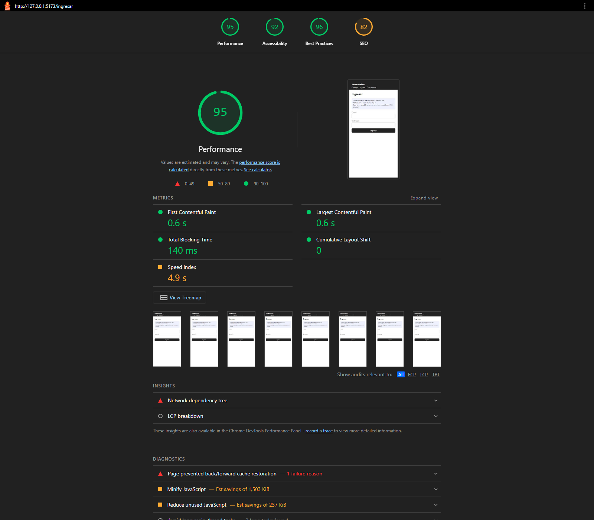

# Matriz de Incidentes y Acta de Certificación – Fase 4

- **Estudiante:** Lucía Milena Hernández Bonilla (HB221258)
- **Rol Fase 4:** DevOps / QA / Base de Datos
- **Proyecto:** CompraLatino (DSE941)

---

## 1. Matriz de Incidentes y Hallazgos

| ID | Tipo | Descripción | Estado |
| :--- | :--- | :--- | :--- |
| **SEC-01** | Seguridad | CORS permisivo (`cors()`) en `backend/src/app.js`. Requiere lista blanca por origen. | Abierto / Mitigación en config |
| **SEC-02** | Seguridad | Dependencias de desarrollo reportadas en `npm audit` sin impacto directo en runtime. | Documentado |
| **UI-01** | Interfaz | Ajustes de responsividad y validación de formularios reportados por Frontend (Fernando). | Resuelto |
| **DT-01** | Deuda Técnica | Automatización de pipeline para escaneo dinámico DAST (ZAP) y benchmarks en CI/CD. | Registrado para Fase 5 |

---

## 2. Auditoría de usabilidad y accesibilidad

- **Fecha:** 29 de octubre de 2026.
- **Alcance:** ingreso, registro, navegación con teclado, detalle de producto y compra.
- **Lighthouse:** CLI 13.6.0 con Microsoft Edge basado, vista móvil, URL `http://127.0.0.1:5173/ingresar`.
- **Puntajes reales:** Rendimiento **95**, Accesibilidad **92**, Buenas prácticas **96**, SEO **82**.
- La auditoría de contraste de Lighthouse pasó en la pantalla de ingreso. Las relaciones de contraste de colores usados en otras vistas se calcularon aparte.

Informe completo: [HTML](./lighthouse_ingreso.report.html) · [JSON](./lighthouse_ingreso.report.json).

| ID | Severidad | Hallazgo | Evidencia | Estado |
| :--- | :--- | :--- | :--- | :--- |
| **UI-02** | Media | Los `label` visibles no están asociados con sus campos mediante `for`/`id` ni con etiquetas ARIA. Lighthouse reporta dos campos sin nombre accesible en ingreso; registro y los campos de dirección/oferta usan el mismo patrón. | [Captura Lighthouse](./lighthouse_ingreso.png) · [Informe HTML](./lighthouse_ingreso.report.html) | Abierto |
| **UI-03** | Media | Hay texto secundario que no alcanza el contraste AA de 4.5:1 para texto normal: `#888` sobre blanco = **3.54:1** y el acento de subasta `#8a6d00` sobre `#fff3cd` = **4.44:1**. El texto blanco sobre el encabezado/botón `#222` alcanza **15.91:1**. | [Catálogo](./F-1_catalogo_1280px.png) · [Detalle](./F-1_detalle_1280px.png) · [Estilos](../../../frontend/src/styles.css) | Abierto |
| **UI-04** | Media | La imagen principal del detalle de producto no tiene atributo `alt`; las tarjetas del catálogo sí usan el título como alternativa. | [Captura de detalle](./F-1_detalle_1280px.png) · [Vista de detalle](../../../frontend/src/views/ProductoDetalleView.vue) | Abierto |
| **UI-05** | Media | Los errores de ingreso y registro se muestran visualmente, pero sus contenedores no tienen `role="alert"` ni `aria-live`; un lector de pantalla puede no anunciar el mensaje al aparecer. | [Vista de ingreso](../../../frontend/src/views/LoginView.vue) · [Vista de registro](../../../frontend/src/views/RegistroView.vue) | Abierto |
| **UI-06** | Baja | El mensaje de ingreso confundía credenciales incorrectas con tokens ausentes o expirados. | [Captura de comprobación](./UI-06_resuelto.png) · [Ruta de ingreso](../../../backend/src/routes/auth.routes.js) · [Prueba de autenticación](../../../backend/test/api/auth.test.js) | **Resuelto:** la API responde “Correo o contraseña incorrectos” para email inexistente o contraseña errónea, sin mencionar tokens ni distinguir si el correo está registrado. |

### Resultado de las pruebas

- **Teclado:** Tab recorre marca, navegación, correo y contraseña en orden lógico; el foco del navegador es visible. La emisión de Enter no pudo confirmarse con el navegador automatizado, que no entregó el evento de teclado al DOM.
- **Errores:** con respuestas locales simuladas, ingreso mostró “Correo o contraseña incorrectos” y registro “Ya existe una cuenta con ese correo”. La API y la base de datos reales no estuvieron disponibles para una prueba de integración.
- **Retorno y compra:** con la API local simulada, el ingreso regresó a `/productos/100` mediante `redirigirA`, la compra mostró confirmación y navegó a `/mis-pedidos`. Esto valida el flujo del frontend, no el backend/pago real.
- **Entorno:** Docker Desktop no estaba activo; por ello no se pudo levantar el stack real. La navegación y la compra se comprobaron contra un mock local, y el informe Lighthouse se ejecutó sobre la SPA local.

---

## 3. Acta de Verificación de Calidad

- **Verificado en Local:**
  - Suite de pruebas ejecutada sin fallos ni omisiones contra el contenedor `cl-test-db` en puerto 5433.
  - Cobertura de líneas alcanzada: **91.41%** (superando el umbral de 80%).
  - Repetibilidad de suite comprobada en dos ejecuciones consecutivas idénticas (`test_coverage_run1.txt` y `test_coverage_run2.txt`).
  - Verificación puntual de consistencia referencial ejecutada (`pedidos` → `usuarios`: 0 huérfanos).
- **No Verificado en Local:**
  - Proceso de extracción, carga y transformación ETL hacia el esquema analítico `dw`.
  - Análisis dinámico con OWASP ZAP (asociado a DT-02).
  - Pruebas de estrés con Autocannon debido a limitaciones de hardware del entorno local.
- **Dictamen:** Entrega técnica aprobada en sus componentes verificados. Se deja constancia de la vulnerabilidad SEC-03 para mitigación por el área de backend.